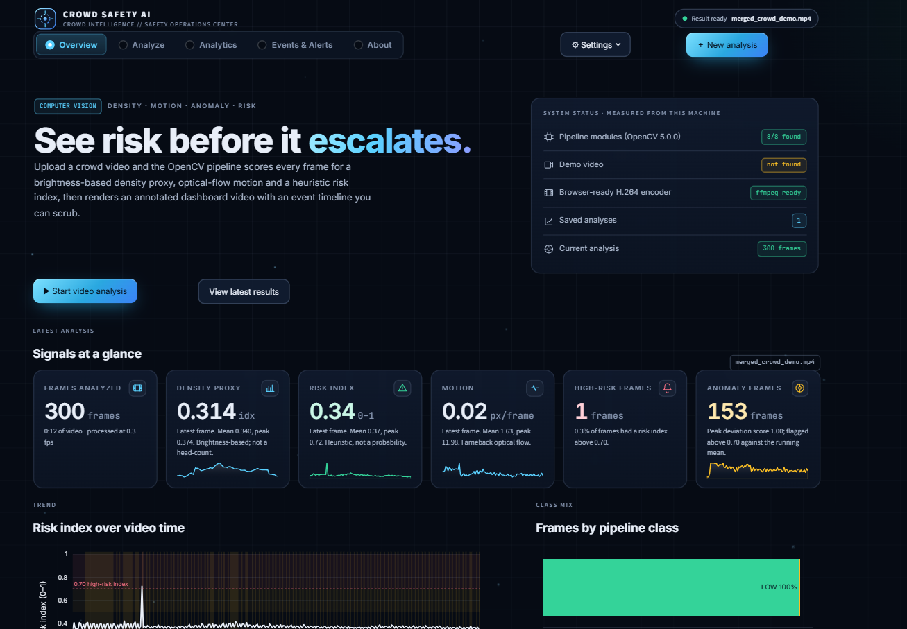
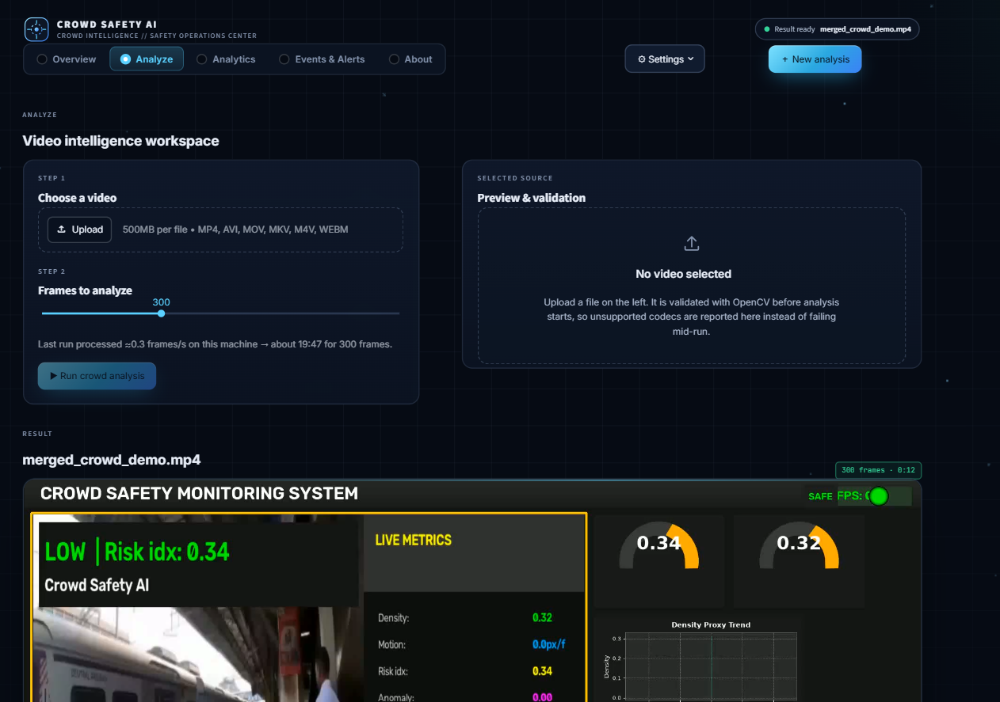
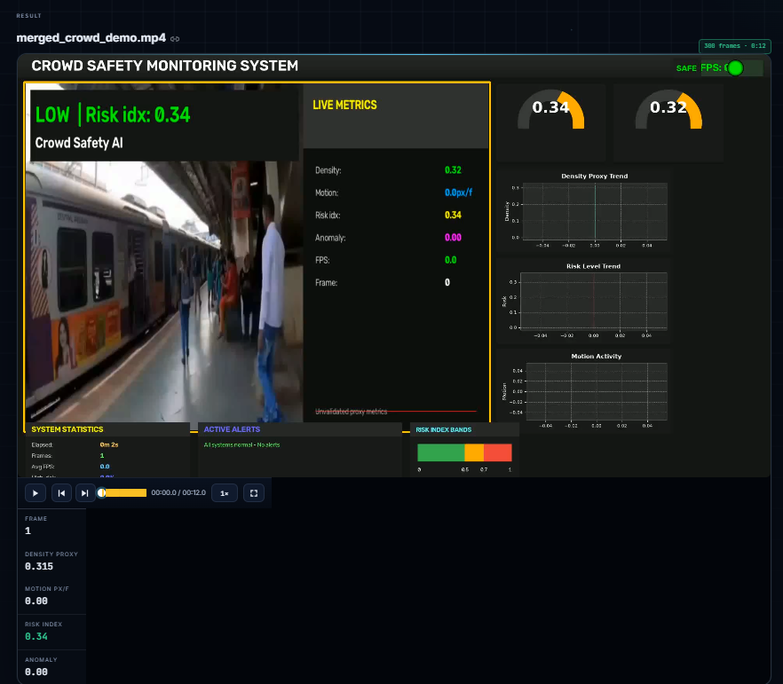
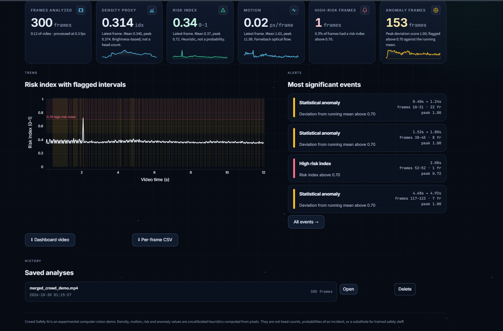
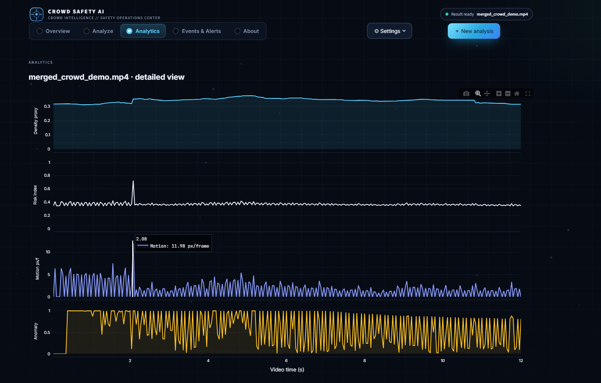
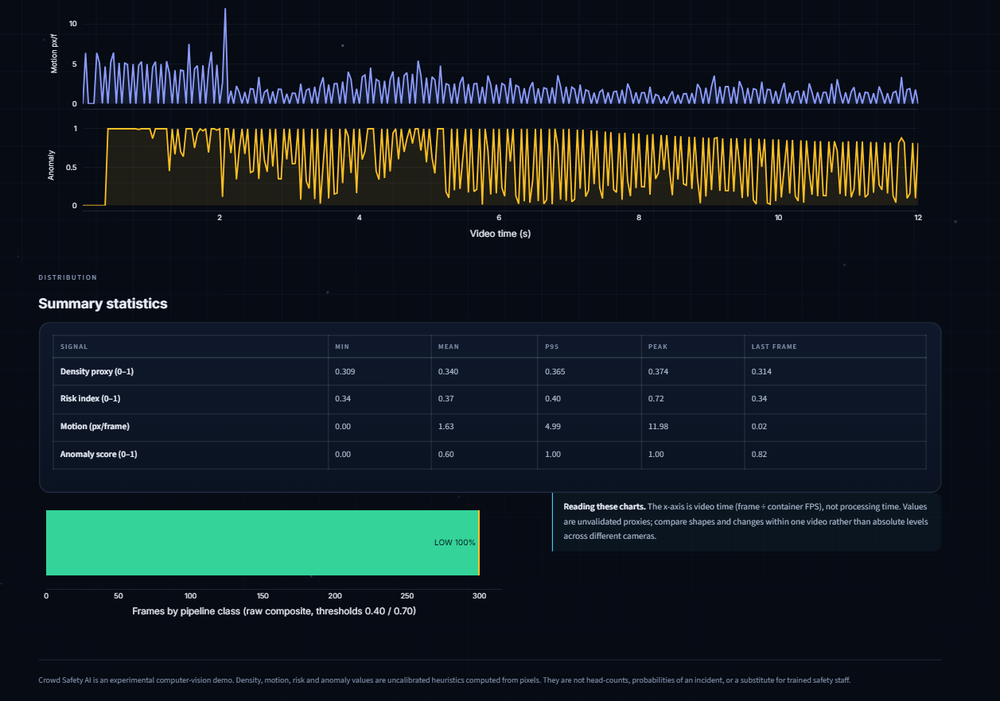
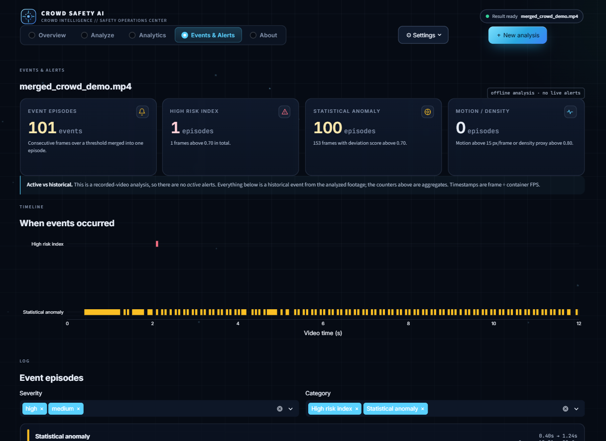
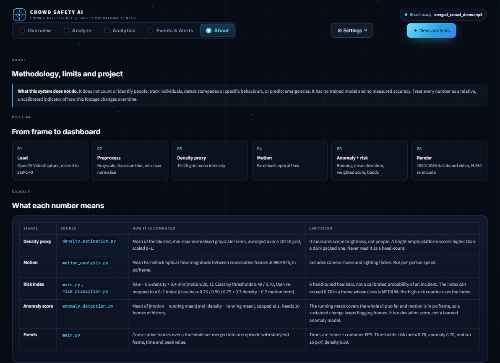
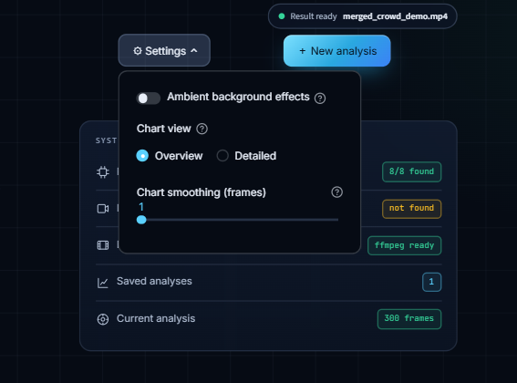

# 🛡️ Crowd Safety AI

**Upload a crowd video and see risk before it escalates: a brightness-based density proxy, optical-flow motion, anomaly scoring and a heuristic risk index, presented in a Streamlit operations-center dashboard.**


Built for **Hackathon Problem Statement 1**. An OpenCV pipeline scores every frame of a crowd video, then the web UI shows an annotated dashboard video with a scrubbable event timeline, linked analytics charts and an event log.



---

## ✨ Features

- **Per-frame analysis**: density proxy, Farneback optical-flow motion, anomaly score and a 0 to 1 risk index (`LOW` / `MEDIUM` / `HIGH`)
- **Annotated dashboard video** with live metrics, gauges and trend graphs, re-encoded to H.264 for browser playback
- **Five-tab operations center**: Overview, Analyze, Analytics, Events & Alerts, About
- **Event episodes**: consecutive flagged frames merged into timed events, with per-frame CSV and events JSON export
- **Reliable runs**: real per-frame progress, cancel button, file validation with readable errors, every run saved in its own `data/outputs/run_*` folder (never overwritten)
- **Honest by design**: every metric is labelled with how it is computed and what it cannot tell you
- **Privacy friendly**: no face detection, no person identification, no tracking

---

## 📸 Screenshots

### Analyze: upload a video and run the pipeline


### Annotated dashboard output


### Results summary


### Analytics: density, risk, motion and anomaly over time




### Events & Alerts


### About: methodology and limits


<details>
<summary>Settings panel</summary>



</details>

---

## 🔬 How it works

```
Video → Preprocess → Density proxy → Motion (optical flow) → Anomaly + risk → Dashboard video
```

| Signal | Computation | Limitation |
|---|---|---|
| **Density proxy** | Mean of the blurred, min-max normalised grayscale frame, averaged over a 10×10 grid, 0 to 1 | Brightness, not people. Not a head count |
| **Motion** | Mean Farneback optical-flow magnitude between frames, in px/frame at 960×540 | Includes camera shake and lighting flicker |
| **Risk index** | `0.6·density + 0.4·min(motion/20, 1)`, classed at 0.40 / 0.70, then mapped to a 0 to 1 index | Hand-tuned heuristic, not a probability |
| **Anomaly score** | Deviation from the running mean of motion and density; flagged above 0.70 | Not a learned model; sustained shifts keep flagging |

| Risk class | Risk index |
|---|---|
| LOW | below 0.40 |
| MEDIUM | 0.40 to 0.70 |
| HIGH | 0.70 and above |

---

## 🚀 Quick start

```bash
git clone https://github.com/RatneshPathak/crowd_safety_ai.git
cd crowd_safety_ai

python -m venv .venv
source .venv/Scripts/activate      # Git Bash on Windows (Linux/macOS: source .venv/bin/activate)
# PowerShell: .\.venv\Scripts\Activate.ps1
pip install -r requirements.txt

streamlit run app.py
```

Then open the **Analyze** tab, upload a video (up to 500 MB: MP4, AVI, MOV, MKV, M4V, WEBM) and choose how many frames to analyze. The **Explore the demo video** button on the Overview tab uses the bundled `data/videos/merged_crowd_demo.mp4`.

**Desktop mode** (original OpenCV window, saves an annotated video to `data/outputs/`):

```bash
python src/main.py
```

Keys: `Q` quit, `P` pause / resume.

**Tests**

```bash
python tests/make_test_video.py     # synthetic clip, not crowd footage
python tests/test_service.py        # service-layer checks, no Streamlit needed
```

---

## ⚙️ Configuration (`config.py`)

Frame size, grid (10×10), frame skip and the risk thresholds (0.40 / 0.70) live in `config.py`. Streamlit theme and upload limits are in `.streamlit/config.toml`.

---

## 📁 Project structure

```
crowd_safety_ai/
├── app.py                  # Streamlit operations-center UI
├── config.py               # Thresholds, grid and video settings
├── requirements.txt
├── .streamlit/config.toml  # Dark theme and upload limit
├── src/                    # Original OpenCV pipeline
│   ├── main.py             # Orchestration (EnhancedCrowdSafetySystem)
│   ├── video_loader.py
│   ├── preprocessing.py
│   ├── density_estimation.py
│   ├── motion_analysis.py
│   ├── anomaly_detection.py
│   ├── risk_classifier.py
│   ├── visualizer.py
│   └── dashboard.py
├── services/analysis.py    # Background job runner and H.264 encoding
├── ui/                     # Theme, components, charts, metrics
├── tests/                  # Synthetic clip and service tests
├── data/                   # Demo video and generated runs
└── docs/screenshots/
```

---

## ⚠️ Limitations

This is an experimental computer-vision demo, not a safety system.

- It does not count or identify people, track individuals, detect specific incidents or predict emergencies.
- No trained model is used and no accuracy has been measured.
- Values are best read as relative changes within one video, not absolute levels across cameras.
- Do not rely on it for real emergency decisions or as a substitute for trained safety staff.

---

## 👥 Team

| Name | Role |
|---|---|
| **Ratnesh Pathak** (Team Lead) | Pipeline integration, operations-center UI |
| Raunak Gupta | Anomaly detection |
| Ayush Jha | Density and motion |
| Ritesh Mishra | Visualization and overlays |

MSc IT, Thakur College of Science & Commerce, Mumbai.

## 🔮 Roadmap

- [ ] Person-level density estimation with a trained model
- [ ] Live webcam / RTSP stream mode
- [ ] Multi-camera support
- [ ] SMS / email alerts

---

Built by [Ratnesh Pathak](https://github.com/RatneshPathak) · See [LICENSE](LICENSE)
